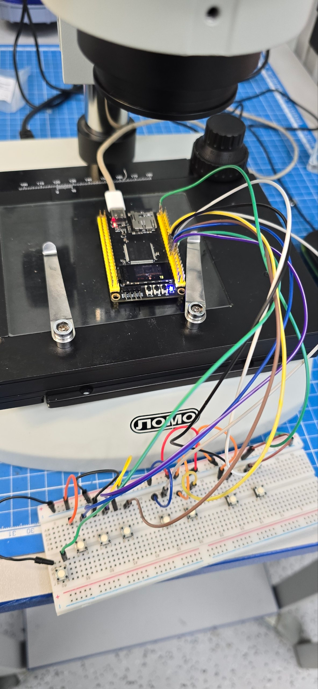
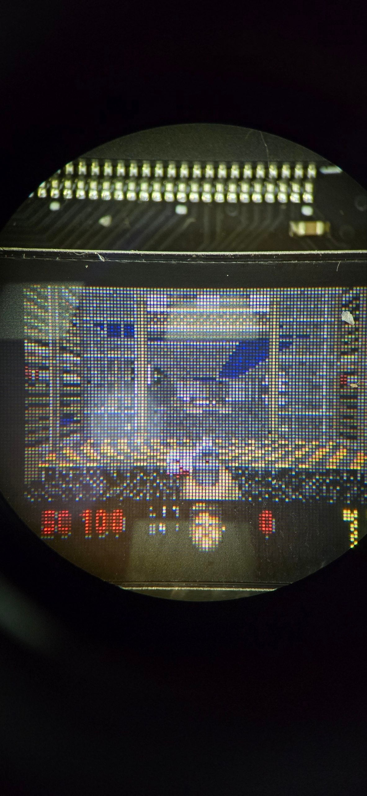

# WeActDoom

[README на русском](README.md)

**Classic DOOM on a WeAct MiniSTM32H723.** Pushbuttons on a solderless breadboard, the stock 160×80 TFT, and a LOMO microscope for a monitor. I built it as a joke, and it turned out to be quite playable.

<p>
  
  
</p>

A port of [GBADoom](https://github.com/doomhack/GBADoom) for the STM32H723VGT6. You can play the classic campaign or try the open-source Freedoom. All game data lives on the microSD card, and the current group of maps is loaded into **8 MiB of OctoSPI flash**. Manual saves and autosaves live on the card too. There's no audio yet. I might add it later.

## Getting started

You'll need:

- A **WeAct MiniSTM32H723** with its stock SPI display
- A microSD card formatted as **FAT32 or exFAT**
- Pushbuttons

You'll also need PlatformIO to build the firmware and Python 3 to prepare the game data. The setup was tested on Windows 11.

Three steps to the ultimate DOOM experience:

1. Run `pio run` from the project root.
2. Flash over USB with an ST-Link probe using `pio run -t upload`. To put the board in USB DFU mode, hold **BOOT0**, briefly press **RESET**, then release **BOOT0**.
3. Prepare the microSD card using one of the methods below, insert it, and press **RESET**. A progress bar appears while the board loads the first pack. Once the DOOM title screen appears, press **K1** or **START**.

### Where do I get a WAD?

| Campaign | File | Source |
| --- | --- | --- |
| Doom Shareware v1.9 | `DOOM1.WAD`, nine maps from the first episode | [Original shareware archive on /idgames](https://legacy.doomworld.com/idgames/idstuff/doom/doom19s) · [ZIP mirror](https://mirrors.lug.mtu.edu/idgames/idstuff/doom/doom19s.zip) |
| Doom Registered, The Ultimate Doom, or Doom II | `DOOM.WAD`, `DOOMU.WAD`, or `DOOM2.WAD` from your own copy of the game | [DOOM + DOOM II on Steam](https://store.steampowered.com/app/2280/) · [GOG](https://www.gog.com/en/game/doom_doom_ii) |
| Freedoom Phase 1 | `freedoom1.wad`, a free campaign with its own maps | [Official Freedoom 0.13.0 release](https://github.com/freedoom/freedoom/releases/tag/v0.13.0) |

### Quick test with Freedoom

```powershell
python tools/prepare_freedoom.py
```

The script verifies the SHA-256 hashes of the archives and bundles the first three Freedoom maps into `DOOM.GBA`. Copy that file to the root of the microSD card.

### Playing the full campaign

```powershell
python tools/prepare_campaign.py "C:\Games\DOOM.WAD"
```

The script downloads GbaWadUtil and creates a `campaign_sd` folder. Copy **`CAMPAIGN.IDX` and all `Pnnn.GBA` files** from that folder to the root of the microSD card.

By default, the script groups maps in packs of three. If a pack is too large for the flash, the script makes smaller packs. You can change the group size with `--maps-per-pack`. When you reach a level in the next pack, the firmware saves your progress, reboots the board, and starts loading that pack.

## Controller

Use ordinary normally open pushbuttons. Connect one terminal of each button to the board's common **GND** and the other to the GPIO listed below. The firmware enables internal pull-ups to 3.3 V.

| Button | GPIO | Action |
| --- | --- | --- |
| ↑ | PA0 | Move forward |
| ↓ | PA1 | Move backward |
| ← | PA2 | Turn left |
| → | PA3 | Turn right |
| **A** | PA4 | Fire, or confirm in menus |
| **B** | PA5 | Use doors and switches, or go back in menus |
| **STRAFE** | PA6 | Hold while pressing ← or → to move sideways |
| **SELECT** | PA7 | Switch to the next weapon. Press with STRAFE to open the map |
| **START** | PA8 | Open the menu or pause. The onboard **K1** works too |

If the buttons behave strangely or fail to respond, use the built-in button test. Hold **K1**, tap **RESET**, and keep holding K1 until **PAD TEST** appears. Yellow shows the raw input state, green shows the debounced press, and the cyan bar stays lit after the first press. PA8 and K1 have separate indicators. [WeAct schematic and documentation](https://github.com/WeActStudio/WeActStudio.MiniSTM32H723)

## Saves

Slots **1–7** are available for manual saves. Slot **8 AUTO** updates when you enter a level.

## If startup stalls

The onboard LED provides a simple way to tell where startup stopped.

| Blue LED flashes or red bars | What to check |
| --- | --- |
| 1 | TFT connection and display initialization |
| 2 | OctoSPI flash access |
| 3 | The microSD card, its filesystem, and whether the required pack is present |
| 4 | Pack size, format, and CRC. The converter must produce `GBAVER=15` |
| 5 | OctoSPI contains unrecognized data. If the import was interrupted, leave the same card in and try rebooting |
| 6 | The pack failed to write or verify. Reboot with the same file |
| 7 | Engine error. Read `engine_error_message` over SWD |
| 8 | Check `CAMPAIGN.IDX` and copy the packs from the same build |

## Authors and license

**sedovnik** came up with the idea, wrote the base code, and assembled and tested the hardware. **Codex (OpenAI)** co-authored the port and helped refine the code and work through technical issues. The project builds on GBADoom, PrBoom, and id Software's original DOOM engine. See [NOTICE.md](NOTICE.md) for credits and copyright notices.

The firmware is distributed under the [GNU GPL v2](LICENSE). Commercial use and distribution are permitted under its terms. If you release a commercial product based on this port, please credit **sedovnik** as the author of WeActDoom.
