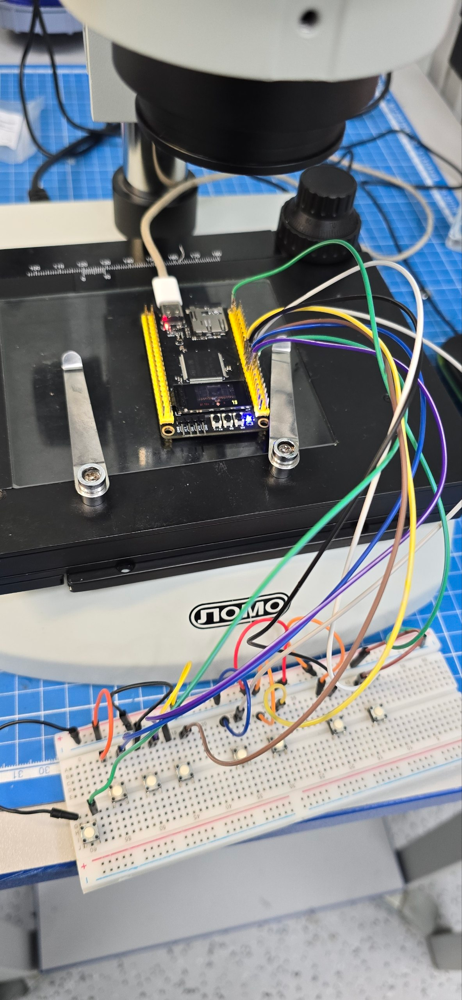
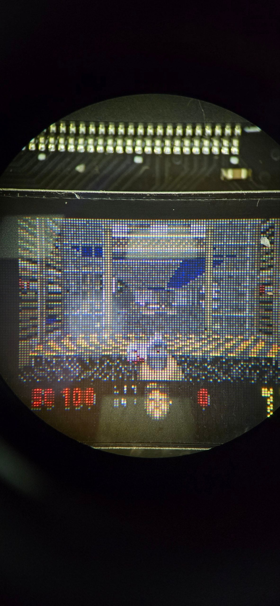

# WeActDoom

[English README](README.en.md)

**Классический DOOM на WeAct MiniSTM32H723.** Кнопки на макетке, штатный TFT 160×80 и ЛОМО вместо монитора. Собрал из интереса, а в итоге под микроскопом оказалось вполне играбельно.

<p>
  
  
</p>

Порт [GBADoom](https://github.com/doomhack/GBADoom) под STM32H723VGT6. На плате можно пройти классическую кампанию из своего IWAD или запустить свободный Freedoom. Вся кампания лежит на microSD, текущая группа карт загружается в **8 МиБ OctoSPI Flash**. Ручные сейвы и автосейв тоже лежат на карте. В этой версии игра работает без звука.

## Быстрый запуск

Понадобятся **WeAct MiniSTM32H723** со штатным экраном, microSD с **FAT32 или exFAT** и кнопки. Для сборки нужен PlatformIO, для подготовки игровых данных — Python 3 на Windows.

1. Выполни `pio run` в корне проекта.
2. Прошей через ST-Link командой `pio run -t upload`. Для USB DFU удерживай **BOOT0**, кратко нажми **RESET**, затем отпусти **BOOT0**. В STM32CubeProgrammer запиши `.pio/build/weact_h723vg/firmware.bin` по адресу `0x08000000`.
3. Подготовь microSD одним из способов ниже, вставь её в плату и нажми **RESET**. Дождись первой загрузки пакета в OctoSPI. На заставке нажми **K1** или **START**, затем **A** на пункте **New Game**.

### Где взять WAD

| Кампания | Какой файл нужен | Источник |
| --- | --- | --- |
| Doom Shareware v1.9 | `DOOM1.WAD`, 9 карт первого эпизода | [Оригинальный shareware-архив на /idgames](https://legacy.doomworld.com/idgames/idstuff/doom/doom19s) · [зеркало ZIP](https://mirrors.lug.mtu.edu/idgames/idstuff/doom/doom19s.zip) |
| Doom Registered, The Ultimate Doom или Doom II | `DOOM.WAD` / `DOOMU.WAD` или `DOOM2.WAD` из своей копии игры | [DOOM + DOOM II в Steam](https://store.steampowered.com/app/2280/) · [GOG](https://www.gog.com/en/game/doom_doom_ii) |
| Freedoom Phase 1 | `freedoom1.wad`, свободная кампания со своими картами | [Официальный выпуск Freedoom 0.13.0](https://github.com/freedoom/freedoom/releases/tag/v0.13.0) |

Игровые WAD и собранные из них пакеты скачиваются или готовятся отдельно. В Git входят исходники прошивки и инструменты подготовки карты.

### Полная кампания

```powershell
python tools/prepare_campaign.py "C:\Games\DOOM.WAD"
```

Скрипт скачает закреплённую версию GbaWadUtil и создаст папку `campaign_sd`. Скопируй из неё **`CAMPAIGN.IDX` и все `Pnnn.GBA`** в корень microSD. Пакеты одной кампании используют один индекс. Оставь карту в плате на протяжении игры.

По умолчанию скрипт группирует карты по три и уменьшает группу, если она превышает лимит **8 384 512 байт**. Размер группы можно поменять через `--maps-per-pack`. Для работы с уже скачанным GbaWadUtil укажи `--converter` и путь к `GbaWadUtil.exe`. При переходе в другую группу плата сохранит точку продолжения, перезапустится и загрузит нужный пакет. На экране будет видна полоска импорта.

### Быстрая проба на Freedoom

```powershell
python tools/prepare_freedoom.py
```

Скрипт проверит SHA-256 архивов и соберёт первые три карты Freedoom в `DOOM.GBA`. Скопируй файл в корень карты. При наличии `CAMPAIGN.IDX` прошивка отдаёт приоритет кампании. Старый одиночный пакет можно заменить, удерживая **K1** при включении и отпустив её при появлении полоски загрузки.

## Геймпад

Используй обычные нормально разомкнутые кнопки. При выключенном питании соедини по одному контакту всех кнопок с общим **GND** платы, например **P2.15**. Вторые контакты идут на GPIO по таблице. Внутренние подтяжки к 3,3 В включены в прошивке.

| Кнопка | GPIO | Контакт на WeAct V1.2 | Действие |
| --- | --- | --- | --- |
| ↑ | PA0 | P2.17 | Вперёд |
| ↓ | PA1 | P2.18 | Назад |
| ← | PA2 | P2.19 | Поворот влево |
| → | PA3 | P2.20 | Поворот вправо |
| **A** | PA4 | P2.21 | Стрельба, в меню подтверждение |
| **B** | PA5 | P2.22 | Двери и переключатели, в меню назад |
| **STRAFE** | PA6 | P2.23 | Удерживай для движения боком через ← и → |
| **SELECT** | PA7 | P2.24 | Следующее оружие. Вместе со STRAFE открывает карту |
| **START** | PA8 | P1.28 | Меню и пауза. Можно использовать штатную **K1** |

Если кнопки ведут себя странно, держи **K1**, кратко нажми **RESET** и продолжай держать K1 до экрана **PAD TEST**. Жёлтая отметка показывает уровень на входе, зелёная — нажатие после фильтра дребезга, голубая полоска остаётся после первого нажатия. PA8 и K1 видны отдельно. Для выхода нажми RESET с отпущенной K1. [Схема и документация WeAct](https://github.com/WeActStudio/WeActStudio.MiniSTM32H723)

## Сохранения

Слоты **1–7** ручные, слот **8 AUTO** обновляется при входе на уровень. При загрузке сейва прошивка сама подбирает пакет карты. Сейв возвращает **к началу карты** со здоровьем, бронёй, оружием и боеприпасами на момент входа. Внутриуровневое состояние, включая положение игрока, открытые двери и убитых врагов, сбрасывается.

Слоты и настройки привязаны к исходному IWAD. Можно разбить тот же WAD на группы другого размера и пользоваться прежними сейвами. Для резервной копии сохрани оба файла `S….DAT` с карты.

## Если запуск остановился

| Вспышки синего LED или красные штрихи | Что проверить |
| --- | --- |
| 1 | Подключение TFT и инициализация дисплея |
| 2 | Доступность OctoSPI Flash |
| 3 | microSD, файловую систему и наличие нужного пакета |
| 4 | Размер, формат и CRC пакета. Конвертер должен выдавать `GBAVER=15` |
| 5 | OctoSPI содержит неизвестные данные. При прерванном импорте оставь ту же карту и попробуй перезапустить |
| 6 | Сбой записи или проверки пакета. Перезапусти с тем же файлом |
| 7 | Ошибка движка. Текст доступен по SWD в `engine_error_message` |
| 8 | Проверь `CAMPAIGN.IDX` и скопируй пакеты из той же сборки |

Классический DOOM запускался и игрался на реальной плате с кнопками на макетке. Переход между пакетами, перенос инвентаря и загрузку сейва из другой группы отдельно проверили в ARM-эмуляторе. Скорость записи microSD и OctoSPI зависит от платы и карты.

## Авторы и лицензия

**sedovnik** — автор проекта, собрал и проверил железо. **Codex (OpenAI)** — соавтор порта, прошивки и инструментов подготовки microSD. Проект основан на GBADoom, PrBoom и исходном движке DOOM от id Software. Подробности и уведомления об авторстве в [NOTICE.md](NOTICE.md).

Прошивка распространяется по [GNU GPL v2](LICENSE). Коммерческое использование и распространение разрешены на условиях лицензии. Если выпустишь коммерческий продукт на базе порта, просьба указать **sedovnik** как автора WeActDoom.
